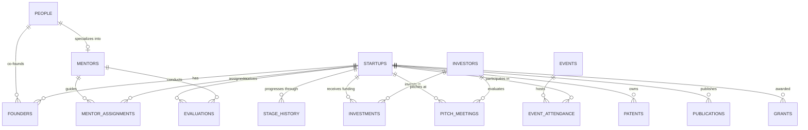
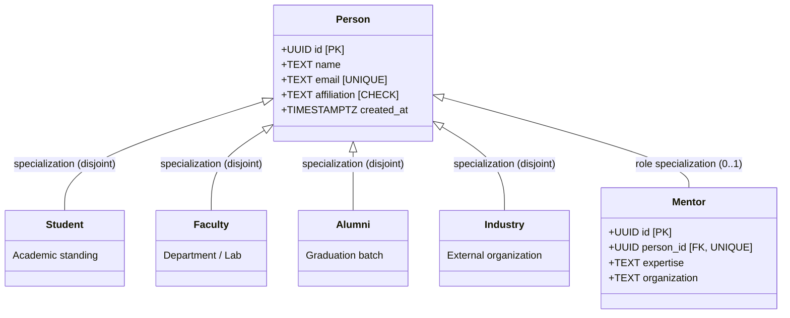

# University Innovation & Startup Incubation Management System
## ER & EER Model Design, Relational Schema & Database Justification

**Project Topic**: University Innovation & Startup Incubation Management  
**Selected Advanced Database**: **CockroachDB** (Distributed Relational SQL Engine)  
**Architecture**: Distributed SQL Backend + Node.js/Express Serverless API + Vanilla Responsive SPA  

---

## 1. Problem Statement Analysis

A modern University Innovation and Startup Incubation Center manages a multi-stakeholder ecosystem:
- **Entrepreneurs & Innovators**: Students, faculty, alumni, and industry members.
- **Startups & Domains**: Ventures categorized into domains (AI, Healthcare, FinTech, AgriTech, Cybersecurity, Green Energy, Other).
- **Incubation Lifecycle**: Progression through discrete stages (*ideation*, *validation*, *incubation*, *acceleration*, *commercialization*) with an immutable stage history audit log.
- **Mentorship**: One-on-one and team guidance by academic and industry experts, including structured metric-driven evaluations (score 1–10).
- **Investment & Pitches**: Investor pitching, scheduled meetings with status tracking (*Scheduled*, *Interested*, *Declined*, *Funded*), and equity/grant investment rounds.
- **Innovation Programs & Events**: Workshops, hackathons, training, demo days, and networking with startup participation tracking.
- **Intellectual Property & Grants**: Patents (Filed, Published, Granted), research publications (with DOI and citation venues), and government/industry grants.

---

## 2. Advanced Database Selection Justification: Why CockroachDB?

The problem requires a **centralized, highly reliable database system** that guarantees **data integrity, minimizes redundancy**, and handles relational joins and audit trails.

| Requirement | CockroachDB (Chosen) | MongoDB (Document) | Neo4j (Graph) | Apache Cassandra |
| :--- | :--- | :--- | :--- | :--- |
| **Referential Integrity** | **Strict Foreign Keys with Cascades** | Manual application-level checks | Relationship properties, no declarative constraints | No foreign keys |
| **ACID Guarantees** | **Full Distributed Serializable ACID (Raft consensus)** | Document-level atomicity; multi-doc is slower | ACID within single instance | Eventual consistency; write conflicts |
| **Relational Joins** | **Native SQL joins (Hash, Merge, Lookup joins)** | Aggregation `$lookup` (inefficient at scale) | Cypher pattern match (great for paths, poor for tabular reports) | Joins unsupported; requires denormalization |
| **Audit Trails & History** | **ACID Transactions (`BEGIN ... COMMIT`)** | Document versioning (prone to race conditions) | Graph revisioning | Append-only tables (risk of duplicate writes) |
| **Horizontal Scalability** | **Auto-partitioning into 64MB Ranges with multi-region support** | Sharding with shard keys | Complex clustered setup | Native distributed ring |
| **PostgreSQL Compatibility** | **PostgreSQL wire-protocol & standard SQL syntax** | Proprietary MQL | Cypher QL | CQL (limited SQL subset) |

### Key Reasons CockroachDB Was Selected:
1. **Financial & Investment Integrity**: Multi-round investments and grants require strict transactional consistency where numbers must match without duplicate or ghost records.
2. **Auditability for Stage Transitions**: Changing a startup's incubation stage is executed inside a database transaction (`BEGIN ... COMMIT`) that simultaneously updates the startup's current stage and appends an immutable entry to `stage_history`.
3. **Complex Analytical Reporting**: Aggregations like total funding by startup, mentor caseloads, and average evaluation scores benefit from CockroachDB's distributed cost-based optimizer (CBO).
4. **Cloud-Native Resilience**: Built on the Pebble storage engine and Raft consensus, CockroachDB survives node and region failures without manual failover.

---

## 3. Entity-Relationship (ER) Model

### Core Entities & Attributes:
- **Startup** (`id`, `name`, `domain`, `description`, `stage`, `founded_on`, `created_at`)
- **Person** (`id`, `name`, `email`, `affiliation`, `created_at`)
- **Mentor** (`id`, `person_id`, `expertise`, `organization`)
- **Investor** (`id`, `name`, `organization`, `email`)
- **Event** (`id`, `title`, `event_type`, `starts_at`, `venue`, `description`)
- **Evaluation** (`id`, `startup_id`, `mentor_id`, `metric`, `score`, `notes`, `evaluated_on`)
- **Investment** (`id`, `startup_id`, `investor_id`, `round_name`, `amount`, `invested_on`)
- **PitchMeeting** (`id`, `startup_id`, `investor_id`, `scheduled_at`, `outcome`, `notes`)
- **Patent** (`id`, `startup_id`, `title`, `application_number`, `status`, `filed_on`)
- **Publication** (`id`, `startup_id`, `title`, `venue`, `published_on`, `doi`)
- **Grant** (`id`, `startup_id`, `provider`, `program`, `amount`, `awarded_on`)
- **StageHistory** (`id`, `startup_id`, `stage`, `notes`, `changed_on`)

### Relationship Cardinalities:
- `People` **1 — M** `Founders` **M — 1** `Startups` (Many-to-Many: Entrepreneurs co-founding ventures).
- `People` **1 — (0..1)** `Mentors` (Specialization).
- `Mentors` **M — N** `Startups` via `mentor_assignments` (Mentors assigned to multiple ventures).
- `Startups` **1 — M** `Evaluations` (Periodic mentor reviews).
- `Investors` **1 — M** `Investments` **M — 1** `Startups` (Funding rounds).
- `Investors` **1 — M** `PitchMeetings` **M — 1** `Startups` (Pitch sessions).
- `Events` **M — N** `Startups` via `event_attendance` (Event participation).
- `Startups` **1 — M** `Patents` (IP filings).
- `Startups` **1 — M** `Publications` (Research papers).
- `Startups` **1 — M** `Grants` (Innovation funding).



---

## 4. Enhanced Entity-Relationship (EER) Model

The EER Model captures the **Specialization / Generalization** hierarchy of individuals participating in the incubation center:

1. **Superclass: `Person`**
   - Shared Attributes: `id` (UUID, PK), `name`, `email` (Unique), `created_at`.
   - Disjoint Subclasses by Affiliation:
     - `Student`: Current university scholars.
     - `Faculty`: Academic researchers and professors.
     - `Alumni`: University graduates turned entrepreneurs.
     - `Industry`: External corporate partners and professionals.
   - Constraint: **Total Specialization** (`affiliation IN ('Student','Faculty','Alumni','Industry')`).

2. **Role Specialization: `Mentor`**
   - Inherits: Foreign key `person_id` referencing `people(id)` with a `UNIQUE` constraint.
   - Subclass-Specific Attributes: `expertise`, `organization`.



---

## 5. Normalization Analysis (1NF to BCNF)

All 15 tables in [`schema.sql`](schema.sql) satisfy **Boyce-Codd Normal Form (BCNF)**:

1. **First Normal Form (1NF)**:
   - All attributes contain only atomic, scalar values (no comma-separated lists or arrays).
   - Each table has a defined Primary Key (`id` or composite PK).
2. **Second Normal Form (2NF)**:
   - All non-key attributes are fully functionally dependent on the entire primary key.
   - Associative tables (`founders`, `mentor_assignments`, `event_attendance`) only maintain attributes dependent on the complete composite key (`role` depends on `(startup_id, person_id)`).
3. **Third Normal Form (3NF)**:
   - There are zero transitive dependencies ($X \to Y$ and $Y \to Z$). For example, mentor expertise is kept in `mentors`, not denormalized into `startups` or `evaluations`.
4. **Boyce-Codd Normal Form (BCNF)**:
   - For every non-trivial functional dependency $X \to Y$, $X$ is a superkey. All alternate candidate keys (`email`, `application_number`, `doi`) have explicit unique indexes.

---

## 6. Relational Schema & Constraints Table

| Table | Primary Key | Foreign Keys | Unique Keys | Check Constraints |
| :--- | :--- | :--- | :--- | :--- |
| `people` | `id` (UUID) | None | `email` | `affiliation IN ('Student','Faculty','Alumni','Industry')` |
| `startups` | `id` (UUID) | None | `name` | `domain IN (...)`, `stage IN (...)` |
| `founders` | `(startup_id, person_id)` | `startup_id` -> `startups(id)`, `person_id` -> `people(id)` | Composite PK | Role defaults to 'Founder' |
| `mentors` | `id` (UUID) | `person_id` -> `people(id)` | `person_id` | Expertise not empty |
| `mentor_assignments` | `(startup_id, mentor_id)` | `startup_id` -> `startups(id)`, `mentor_id` -> `mentors(id)` | Composite PK | `assigned_on` valid date |
| `stage_history` | `id` (UUID) | `startup_id` -> `startups(id)` | None | `stage IN (...)` |
| `evaluations` | `id` (UUID) | `startup_id` -> `startups(id)`, `mentor_id` -> `mentors(id)` | None | `score BETWEEN 1 AND 10` |
| `investors` | `id` (UUID) | None | `name`, `email` | None |
| `pitch_meetings` | `id` (UUID) | `startup_id` -> `startups(id)`, `investor_id` -> `investors(id)` | None | `outcome IN ('Scheduled','Interested','Declined','Funded')` |
| `investments` | `id` (UUID) | `startup_id` -> `startups(id)`, `investor_id` -> `investors(id)` | `(startup_id, investor_id, round_name)` | `amount > 0` |
| `events` | `id` (UUID) | None | None | `event_type IN ('Workshop','Hackathon','Training','Demo Day','Networking')` |
| `event_attendance` | `(event_id, startup_id)` | `event_id` -> `events(id)`, `startup_id` -> `startups(id)` | Composite PK | None |
| `patents` | `id` (UUID) | `startup_id` -> `startups(id)` | `application_number` | `status IN ('Filed','Published','Granted')` |
| `publications` | `id` (UUID) | `startup_id` -> `startups(id)` | `doi` | None |
| `grants` | `id` (UUID) | `startup_id` -> `startups(id)` | None | `amount > 0` |

---

## 7. Complex SQL Queries & Aggregations Demonstrated

### Query 1: Total Funding & Rounds per Startup
```sql
SELECT 
    s.id,
    s.name,
    s.domain,
    s.stage,
    COALESCE(SUM(i.amount), 0) AS total_investment,
    COUNT(i.id)::INT AS completed_rounds
FROM startups s
LEFT JOIN investments i ON i.startup_id = s.id
GROUP BY s.id, s.name, s.domain, s.stage
ORDER BY total_investment DESC, s.name;
```

### Query 2: Mentor Caseload & Guidance Distribution
```sql
SELECT 
    m.id,
    p.name AS mentor_name,
    m.expertise,
    COUNT(a.startup_id)::INT AS assigned_startups
FROM mentors m
JOIN people p ON p.id = m.person_id
LEFT JOIN mentor_assignments a ON a.mentor_id = m.id
GROUP BY m.id, p.name, m.expertise
ORDER BY assigned_startups DESC;
```

### Query 3: Multi-Metric Performance Score Averages
```sql
SELECT 
    s.name AS startup,
    e.metric,
    ROUND(AVG(e.score)::DECIMAL, 1) AS average_score,
    COUNT(*)::INT AS review_count
FROM evaluations e
JOIN startups s ON s.id = e.startup_id
GROUP BY s.name, e.metric
ORDER BY s.name, e.metric;
```

### Query 4: Transactional Incubation Stage Update & History Audit Log
```sql
BEGIN;
UPDATE startups SET stage = 'acceleration' WHERE id = '8c3d8e5b-...' RETURNING *;
INSERT INTO stage_history (startup_id, stage, notes) 
VALUES ('8c3d8e5b-...', 'acceleration', 'Approved for accelerator after seed round');
COMMIT;
```
